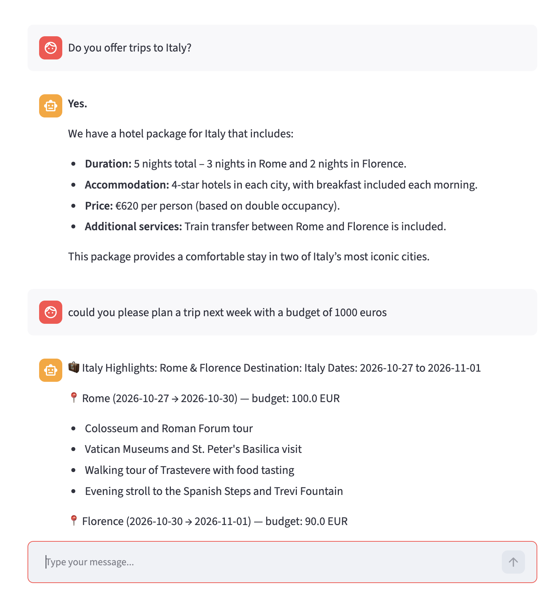
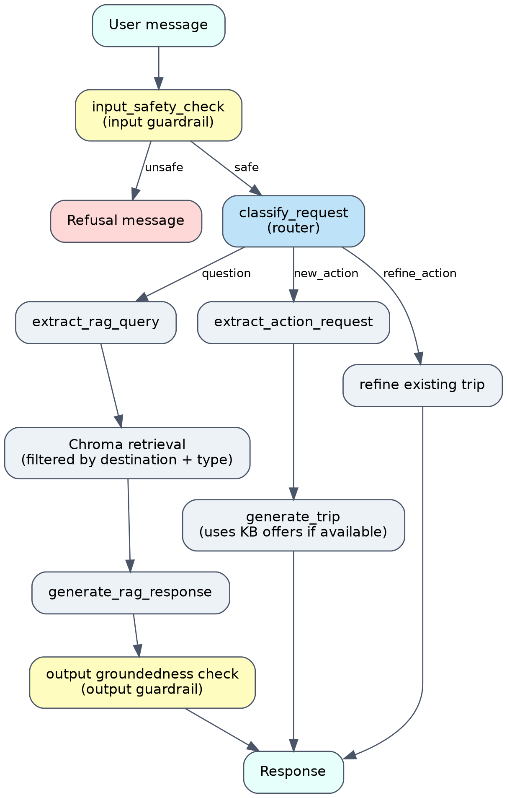

# ✈️ Travel Agency Chatbot (LangGraph)

A conversational assistant for a travel agency. It answers questions about the agency's destinations and offers using RAG, and it builds or refines complete trip plans (destination, duration, budget, preferences) using real agency prices when they exist in the knowledge base.

Built as the capstone of an AI/LLM engineering course: LangGraph orchestration, RAG, structured outputs, multi-turn memory, guardrails, LangSmith evaluation and Docker deployment.

<!-- TODO: add a screenshot or GIF of the Streamlit app here, ideally a multi-turn flow (generate a trip, then refine it) -->


## Features

- **Two request paths**
  - **Questions**: answered with RAG over the agency's destination guides and hotel/flight offers.
  - **Actions**: generate a full trip plan, or refine an existing one from free-text feedback (e.g. *"I don't like the museum, replace it with a beach activity"*).
- **Real pricing**: if the knowledge base holds hotel/flight offers for a destination, the generated trip uses them; otherwise the LLM estimates.
- **Multi-turn memory**: conversation state persists across turns with a LangGraph checkpointer and a `thread_id`.
- **Guardrails**
  - *Input*: blocks off-topic requests and jailbreak attempts.
  - *Output*: a groundedness check prevents the bot from confirming facts that are not in the knowledge base.
- **Observability and evaluation**: LangSmith tracing and a multi-turn evaluation dataset replayed end to end through the graph.
- **Configurable LLM provider**: local Ollama (`llama3.2`) or Groq (`openai/gpt-oss-120b`), switched with an environment variable.
- **Dockerized**: one `docker compose up` to run the Streamlit app.

## Architecture



**Knowledge base.** A single Chroma collection, `travel-guide`, holds documents tagged with metadata: `destination` and `type` (`general_info`, `hotel_offer`, `flight_offer`). Retrieval filters on these tags rather than using a similarity threshold, so `generate_trip` can reliably pick up the agency's real offers for a given destination. The current KB covers Algeria, Italy, Greece and Qatar.

**State and models.** Pydantic models (`TravelStop`, `Trip` with computed budget fields, `RouterOutput`, `ActionRequest`, `RAGQuery`, `SafetyCheck`) structure the LLM outputs and the graph state.

## Tech stack

| Area | Tools |
|---|---|
| Orchestration | LangGraph, LangChain |
| LLM | Ollama (`llama3.2`) or Groq (`openai/gpt-oss-120b`) |
| Vector store | ChromaDB (persistent, local) |
| Validation | Pydantic |
| Frontend | Streamlit |
| Observability and evals | LangSmith |
| Deployment | Docker, Docker Compose |

## Project structure

```
.
├── data/          # kb.json (knowledge base source) and Chroma persistence (chroma_db/)
├── evals/         # LangSmith dataset and evaluation scripts
├── frontend/      # Streamlit app (app.py)
├── functions/     # Node functions of the graph
├── graph/         # LangGraph graph definition
├── guardrails/    # Input and output guardrails
├── models/        # Pydantic models
├── prompts/       # Prompt templates
├── tools/         # Tools used by the agent
├── main.py
├── requirements.txt
├── Dockerfile
└── docker-compose.yml
```

## Getting started

### Prerequisites

- Python 3.11+
- Docker and Docker Compose (for the containerized run)
- Either [Ollama](https://ollama.com) with `llama3.2` pulled, or a [Groq](https://console.groq.com) API key
- (Optional) a [LangSmith](https://smith.langchain.com) API key for tracing and evaluation

### 1. Clone and configure

```bash
git clone https://github.com/souhila1806/travel_agency_chatbot.git
cd travel_agency_chatbot
```

Create a `.env` file at the project root. It is listed in `.gitignore` and `.dockerignore`, so it is never committed or copied into the Docker image.

```env
# LLM provider: ollama (default) or groq
LLM_PROVIDER=groq

# Required only when LLM_PROVIDER=groq
GROQ_API_KEY=your_groq_api_key
GROQ_MODEL=openai/gpt-oss-120b

# Optional: LangSmith tracing and evaluation
LANGSMITH_TRACING=true
LANGSMITH_API_KEY=your_langsmith_api_key
```

| Variable | Description |
|---|---|
| `LLM_PROVIDER` | `ollama` (default) or `groq` |
| `GROQ_API_KEY` | Required when `LLM_PROVIDER=groq` |
| `GROQ_MODEL` | Groq model name, e.g. `openai/gpt-oss-120b` |
| `OLLAMA_BASE_URL` | Ollama endpoint. Set by `docker-compose` when running in Docker; only needed for a local run if Ollama is not at its default address |
| `LANGSMITH_API_KEY` | Optional, enables tracing and evaluation |
| `LANGSMITH_TRACING` | Optional, set to `true` to enable tracing |

> Never commit your `.env` file or API keys.

###
